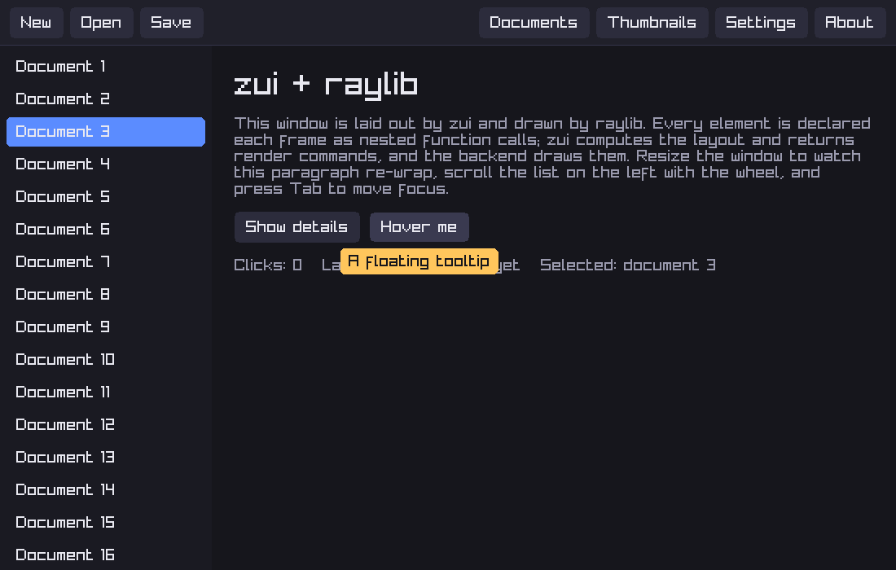
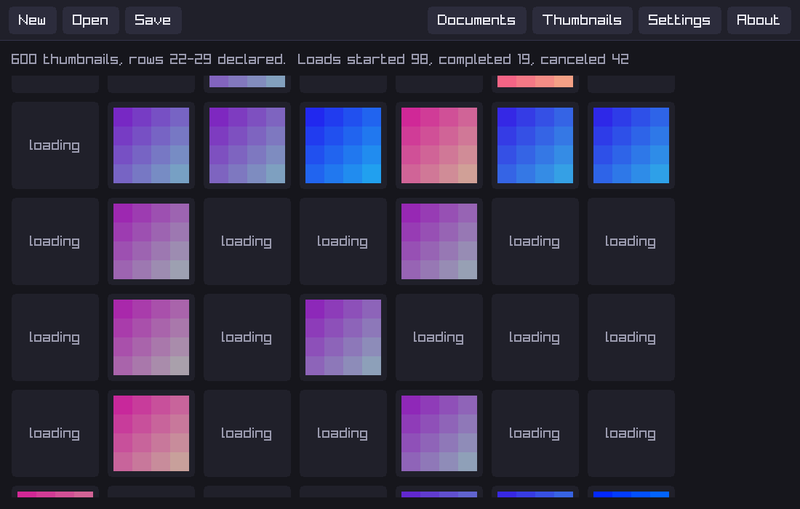
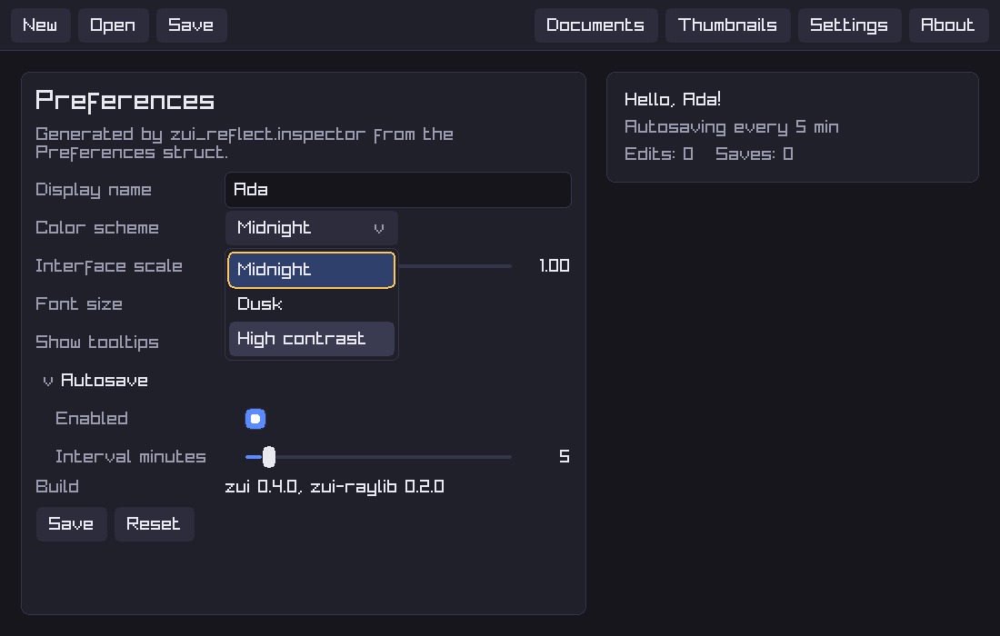

# zui-raylib

A [raylib](https://www.raylib.com) backend for
[zui](https://github.com/AaronJClausen/zui): it reads raylib input into
`zui.Input`, measures text with raylib fonts, and draws zui's render
commands. It also contains zui's reference application.



## Requirements

- Zig **0.16.0**
- raylib **6.0**, fetched automatically. It is the newest raylib release
  whose build supports Zig 0.16.
- On Linux, raylib's X11 and OpenGL development packages:
  `libx11-dev libxrandr-dev libxinerama-dev libxcursor-dev libxi-dev libgl1-mesa-dev`

## Run the demo

```sh
zig build demo
zig build demo -- --screenshot demo.png           # render offscreen and save a PNG
zig build demo -- --screenshot demo.png --about   # ...with the About dialog open
zig build demo -- --screenshot grid.png --thumbnails  # ...in the thumbnail grid
zig build demo -- --screenshot settings.png --settings  # ...in the settings editor
```

The demo shows every zui feature through 0.4:
- toolbar buttons from `zui_widgets`, with hover, press and focus states;
- a scrollable, selectable list (scroll with the wheel);
- wrapped text that re-wraps as the window resizes;
- a toggle whose state lives in zui's state table;
- a floating tooltip;
- an About dialog that keeps Tab focus inside it;
- a **Thumbnails** view: a grid of 600 cells where each thumbnail loads in
  a zui `TaskPool` (200–800 ms of simulated I/O). Only the rows near the
  visible area are declared, so scrolling away cancels their pending
  loads. The header counts loads started, completed and canceled;
- a **Settings** view generated by `zui_reflect.inspector` from a
  `Preferences` struct: a text field, a dropdown, a slider, a stepper,
  checkboxes, a collapsible nested struct and read-only text, all
  configured by one typed `zui_inspector` declaration. The card beside it
  shows the values live.





Press Tab and Shift-Tab to move focus, and Enter or Space to activate.

## Use it in your application

```sh
zig fetch --save git+https://github.com/AaronJClausen/zui-raylib
```

```zig
// build.zig
const backend = b.dependency("zui_raylib", .{ .target = target, .optimize = optimize });
exe.root_module.addImport("zui_raylib", backend.module("zui_raylib"));
```

```zig
const zui_raylib = @import("zui_raylib");
const zui = zui_raylib.zui; // the same zui the backend was built with
const zui_widgets = zui_raylib.zui_widgets; // and its optional modules
const zui_reflect = zui_raylib.zui_reflect;
const c = zui_raylib.c;

const Ui = zui.Context(zui_raylib.config(.{}), zui_raylib.Platform);

var platform: zui_raylib.Platform = .{}; // or .{ .fonts = &my_fonts }
var ui = try Ui.init(gpa, io, &platform);

while (!c.WindowShouldClose()) {
    var reader: zui_raylib.InputReader = .{};
    ui.beginFrame(reader.read(.{}));
    // ... declare your UI ...
    const frame = ui.endFrame() catch ui.lastFrame();
    c.BeginDrawing();
    c.ClearBackground(.{ .r = 22, .g = 22, .b = 28, .a = 255 });
    zui_raylib.render(Ui.RenderCommand, &platform, frame.commands(), .{});
    // Sleep in EndDrawing until input or a task wakes us, unless the frame
    // just drawn may already be out of date.
    if (ui.needsFrame()) c.DisableEventWaiting() else c.EnableEventWaiting();
    c.EndDrawing();
    ui.release(frame);
}
```

`zui_raylib.config(...)` sets `ImageHandle` to raylib's `Texture2D`, so
`ui.image(texture, ...)` draws directly. Other payload types can be
drawn with the `draw_image` and `draw_custom` hooks in `RenderOptions`.
With that loop, an idle application uses no CPU. `Platform.wake` ends
raylib's event wait when a background task completes, using
`glfwPostEmptyEvent` (compiled into raylib's default desktop GLFW
platform). Measured with the demo in a hidden window: 0.0 ms of CPU over
10 idle seconds in each view. The same build with event waiting
disabled used 1,515.6 ms over those 10 seconds.

## What the backend maps, and how

| zui | raylib |
|---|---|
| `rectangle` | `DrawRectangleRec`, or `DrawRectangleRounded` with a corner radius |
| `border` | four bands inside the bounds; `DrawRectangleRoundedLinesEx` when uniform and rounded |
| `text` | `DrawTextEx`, one call per wrapped line |
| `image` | `DrawTexturePro` |
| `clip_begin` / `clip_end` | `BeginScissorMode` / `EndScissorMode` with a stack |
| wheel | `GetMouseWheelMoveV`, flipped and scaled by `InputOptions.wheel_step` |

Two raylib limits are worth knowing:
- **Corner radii.** raylib rounds all four corners the same, so the
  largest of zui's four radii is used.
- **Letter spacing.** Text is measured glyph by glyph with the spacing
  after each glyph included. zui measures words and spaces separately and
  adds them up, so measurement has to be additive. raylib's own
  `MeasureTextEx` leaves out the spacing after the last glyph, which
  under-measures every word and made text overflow its box in early
  testing.

## License

MIT; see [LICENSE](LICENSE).
